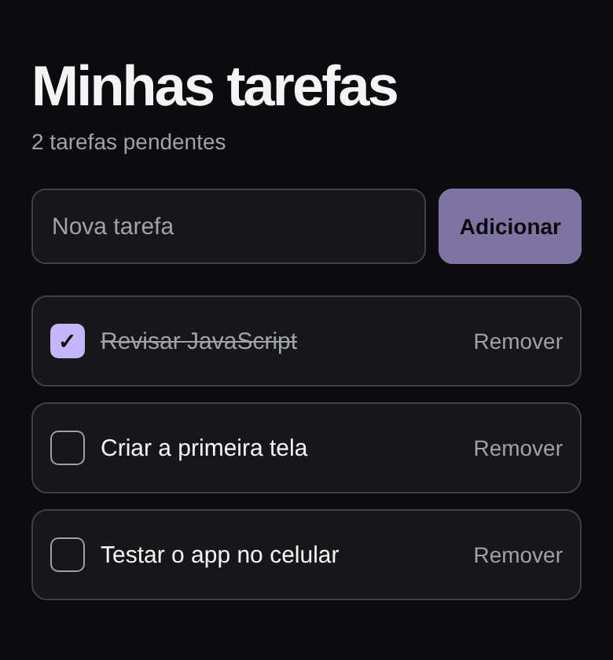

<p align="center">
  
  
  
</p>

<p align="center">
  <a href="#-tecnologias">Tecnologias</a>&nbsp;&nbsp;&nbsp;|&nbsp;&nbsp;&nbsp;
  <a href="#-projeto">Projeto</a>&nbsp;&nbsp;&nbsp;|&nbsp;&nbsp;&nbsp;
  <a href="#-como-executar">Como executar</a>&nbsp;&nbsp;&nbsp;|&nbsp;&nbsp;&nbsp;
  <a href="#-roteiro-didático">Roteiro didático</a>
</p>

# Lista de tarefas

<p align="center">
  
</p>

## 🚀 Tecnologias

- **React Native e Expo** para executar a aplicação no celular e no navegador.
- **JavaScript e JSX** para representar os dados e descrever a interface.
- **StyleSheet** para os estilos da tela.
- **`useState`** para gerenciar o texto digitado e a lista.

## 🚧 Projeto

Aplicativo de uma tela criado para a disciplina **Programação de Aplicativos**, no 2º semestre do curso técnico em Desenvolvimento de Sistemas do **SENAI Dendezeiros**.

A tela permite adicionar, concluir, reabrir e remover tarefas. O contador de pendências acompanha as mudanças na lista. Os dados ficam na memória e voltam aos valores iniciais ao recarregar o app.

## 🧰 Pré-requisitos

- Node.js 24 LTS, na série 24.3 ou posterior, e npm.
- Para testar no celular, Expo Go compatível com o SDK 58 e acesso à mesma rede do computador. [Configuração do ambiente Expo](https://docs.expo.dev/get-started/set-up-your-environment/)

## 💻 Como executar

```sh
git clone https://github.com/filipebteixeira98/tasks-app.git
cd tasks-app
npm ci
npm run web
```

Abra o endereço exibido no terminal. Para testar no celular, execute `npm start` e abra o projeto no Expo Go.

No kit da aula, a pasta `04-demo-offline` contém uma demonstração em HTML que abre diretamente no navegador.

## 📚 Roteiro didático

1. Abra `src/screens/TaskScreen.js` e leia `initialTasks`. Cada tarefa tem `id`, `title` e `done`.
2. Encontre `draft` e `tasks` em `useState`. Siga o campo de texto até `setDraft`.
3. Leia `addTask`, `toggleTask` e `removeTask`. Observe como cada operação cria uma nova lista.
4. Encontre `tasks.map`, que desenha as linhas, e `pendingCount`, calculado a partir da lista.
5. Como desafio, exiba `tasks.length` e compare com o número de pendências.

`index.js` registra o app no Expo. `App.js` aponta para a tela, onde ficam a lógica e os estilos. O `useRef` mantém disponível o próximo identificador entre renderizações.

[Guia de publicação no GitHub](PUBLISHING.md) · [Estado no React](https://react.dev/reference/react/useState) · [Arrays no estado](https://react.dev/learn/updating-arrays-in-state)
